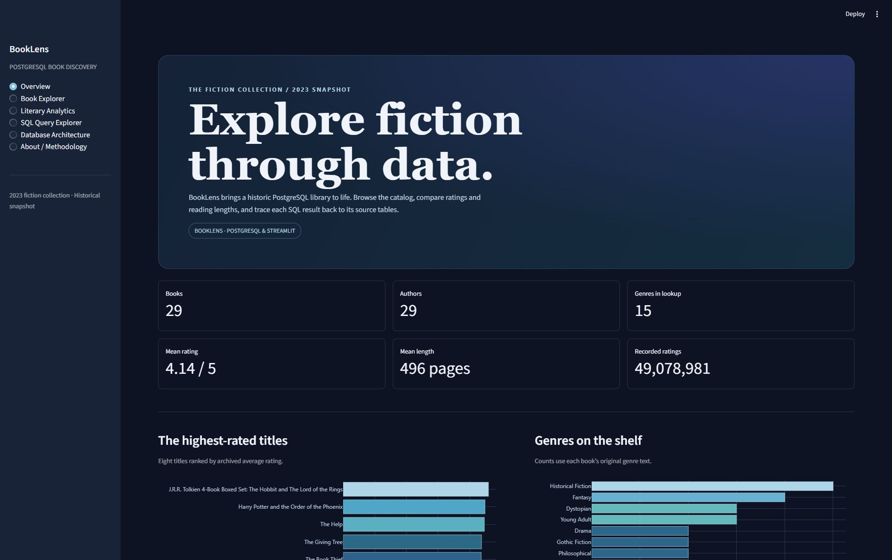

# BookLens

**PostgreSQL Book Discovery & Analytics**
*Explore fiction through data.*

BookLens turns a collaborative 2023 fiction-library database into an interactive catalog and SQL portfolio. Search 29 books, explore ratings and reading length, and follow five SQL analyses from the original relational schema to verified results.

**[Open the live BookLens dashboard](https://booklens-louidowu.streamlit.app/)**

[Historical database](legacy/original_database.sql) · [Original queries](legacy/original_queries.sql) · [Modernized queries](sql/queries.sql) · [Project evolution](docs/original-vs-modern.md)



## Explore the dashboard

| Page | What you can do |
| --- | --- |
| Overview | See six catalog metrics, top-rated titles and the distribution of book genre labels |
| Book Explorer | Search titles, combine author, genre and rating filters, sort results and open book details |
| Literary Analytics | Compare pages, ratings and recorded audience activity by genre |
| SQL Query Explorer | Read five highlighted PostgreSQL queries and inspect their verified output tables |
| Database Architecture | Explore the ER diagram, schema, keys and snapshot pipeline |
| About and Methodology | Review the project's origin, analytical choices and limitations |

See the [Book Explorer](docs/screenshots/book-explorer.jpg), [SQL Query Explorer](docs/screenshots/sql-query-explorer.jpg), and [Database Architecture](docs/screenshots/database-architecture.jpg) in screenshots from the running app.

## What the snapshot shows

- The 29 books average **4.14 out of 5** and **496 pages**.
- Historical Fiction appears on five books, followed by Fantasy on four. The books contain 14 distinct genre labels and the genre lookup has 15 rows.
- The archived book records contain **49,078,981 rating events in total**. Readers may have rated multiple books.
- The catalog contains a boxed set, so the page-count and rating comparisons reflect the records as supplied.

## Architecture and SQL

```text
public.books.author_id → public.authors.author_id
public.authors.genre_id → public.genres.genre_id

PostgreSQL 15.1 TAR → isolated PostgreSQL reconstruction → CSV snapshot → Streamlit
```

Book genre labels come from `books.genres`. Query 5 follows `authors.genre_id` to the genre lookup. The [SQL audit](docs/sql-audit.md) explains the joins, filters, scalar and correlated subqueries, aggregation, and original-to-revised result checks. See [schema](sql/schema.sql), [queries](sql/queries.sql), and [example outputs](data/queries).

The app uses Python 3.12, pandas, Streamlit, and Plotly. The archive's tables and data were reconstructed in an isolated embedded PostgreSQL 17.5 database and all five query results were independently cross-checked. Streamlit reads the bundled CSV files and needs no database connection, credentials, cover APIs, or local drive paths.

## Run locally

```sh
python -m venv .venv
# Activate .venv for your shell, then:
python -m pip install -r requirements.txt
python -m unittest discover -s tests -v
python -m streamlit run streamlit_app.py
```

## Reproduce the snapshot

Use PostgreSQL 15 or a newer compatible version. Use a separate server or cluster and create a fresh database. Configure standard libpq connection options in your environment.

```sh
pg_restore --list /path/to/Team_08_library_backup.sql
createdb library_portfolio
pg_restore --exit-on-error --single-transaction --no-owner --no-privileges --dbname=library_portfolio /path/to/Team_08_library_backup.sql
python scripts/export_snapshot.py
```

The historical file is a TAR archive despite its extension. The archive's generated restore script contains database-level operations targeting `postgres`. The command above targets `library_portfolio` and omits both `--create` and `--clean`. The original archive is retained separately. The export runs all table and query reads within one read-only transaction. A [readable historical reconstruction](legacy/README.md) is also available and includes the original schema and sample rows.

## Deploy

In [Streamlit Community Cloud](https://share.streamlit.io/), create an app from `LouIdowu/BookLens` on branch `main`. Select `streamlit_app.py` and Python 3.12. The public deployment is available at [BookLens on Streamlit](https://booklens-louidowu.streamlit.app/).

## Data scope

The 2023 University of Maryland fiction-library project was a team effort. Its Goodreads-related metadata is an archived sample, with limited coverage of editions and collection dates. Averages describe this catalog. Future work could add dated snapshots, edition identifiers, and junction tables for multiple contributors and genre labels.
